# FitForge — Gym Management System

A full-stack gym management system for admins, trainers and members, built with **ASP.NET Core Web API (.NET 10)**, **Entity Framework Core**, **SQL Server** and **React + TypeScript**.

Admins run the business (members, trainers, plans, memberships, payments, classes, audit log). Trainers write workout and diet plans for their own members and run their classes. Members book classes, follow their plans and track their membership. Every role sees only what it is allowed to see, and the API enforces that too, not just the UI.

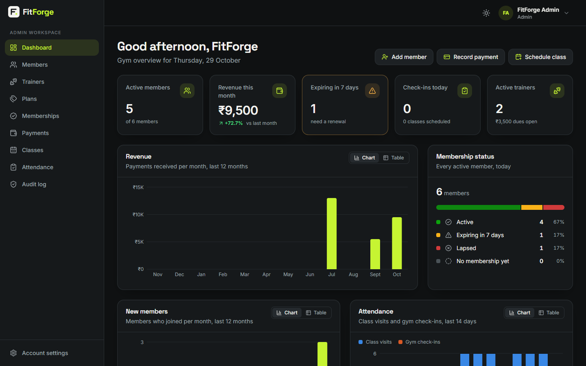

---

## Highlights

- **3 roles, 3 dashboards**: live KPIs and charts for admins, trainers and members, in dark and light themes.
- **61 REST endpoints** across members, trainers, plans, memberships, payments, workout and diet plans, classes, bookings, attendance and audit logs.
- **Secure authentication**: ASP.NET Core Identity, short-lived JWT access tokens (15 min) kept in memory, and **rotating refresh tokens** in an HttpOnly, SameSite=Strict cookie, stored hashed. Reusing a stolen refresh token revokes the whole session.
- **Authorization in two layers**: role policies (Admin / Trainer / Member), plus resource-level checks. A member asking for someone else's record gets **404**, so record IDs can't be probed (IDOR protection).
- **Real business rules**: renewals that start when the current membership ends, no overlapping memberships, part payments with balances, class capacity with **race-safe booking** (row locks), a 2-hour cancellation window, and attendance check-ins.
- **Hardening**: rate limiting (5 logins/min per IP), strict CORS, security headers (CSP, nosniff, frame DENY), account lockout, request size limits, consistent ProblemDetails errors, structured JSON logs (Serilog), and an append-only **audit log** of admin actions and security events.
- **233 automated checks**: unit, integration (real API + real SQL Server), client unit tests and browser end-to-end suites.

---

## Screenshots

| | |
|---|---|
| 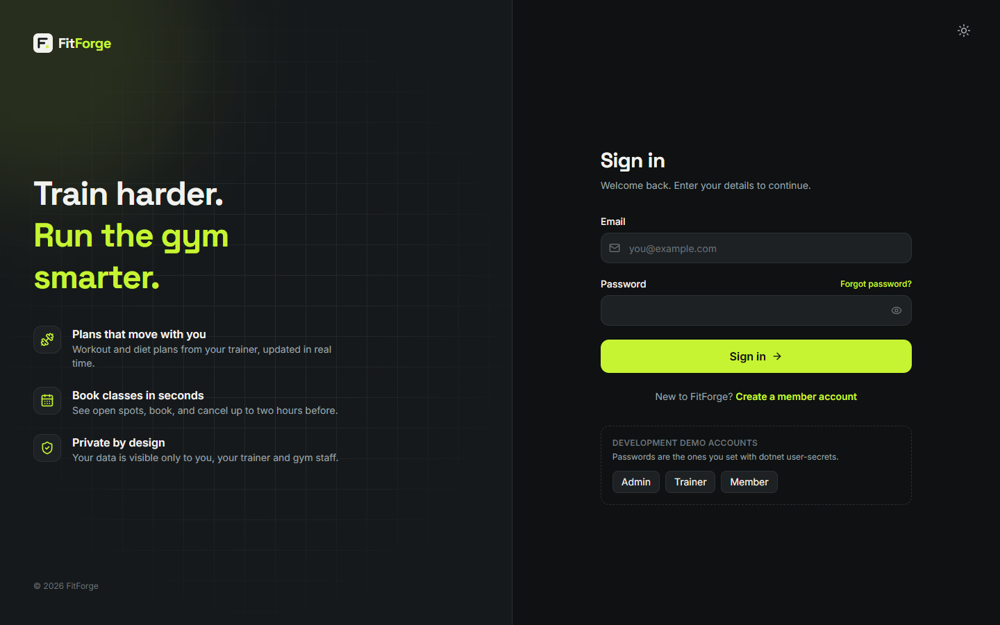 **Sign in**: demo account shortcuts in development | 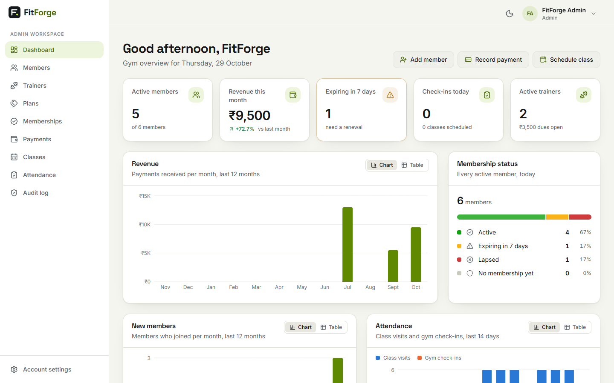 **Light theme**: charts repaint with their own light-mode palette |
| 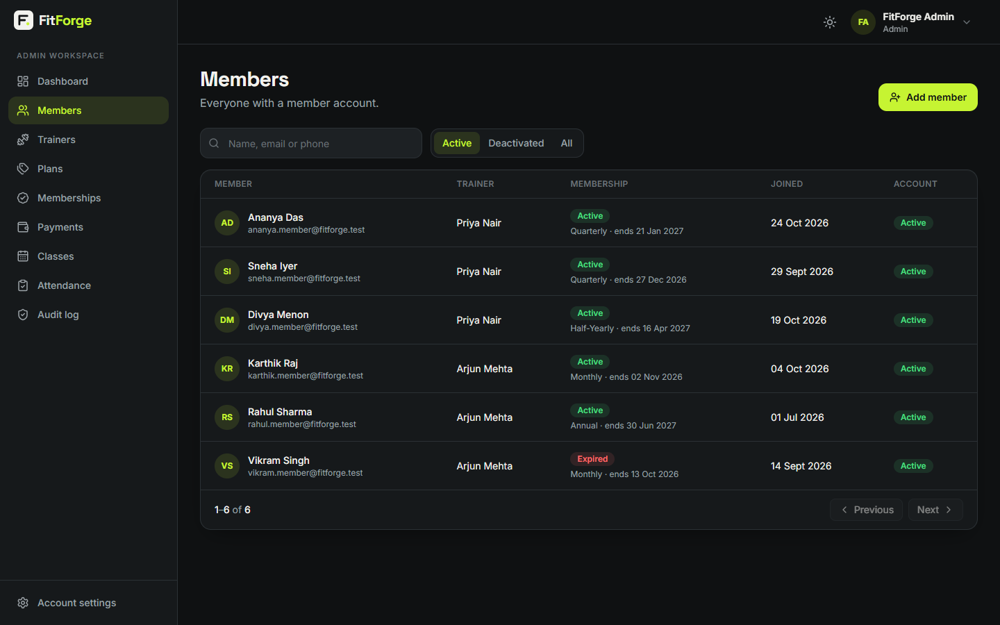 **Members**: search, filters, paging | 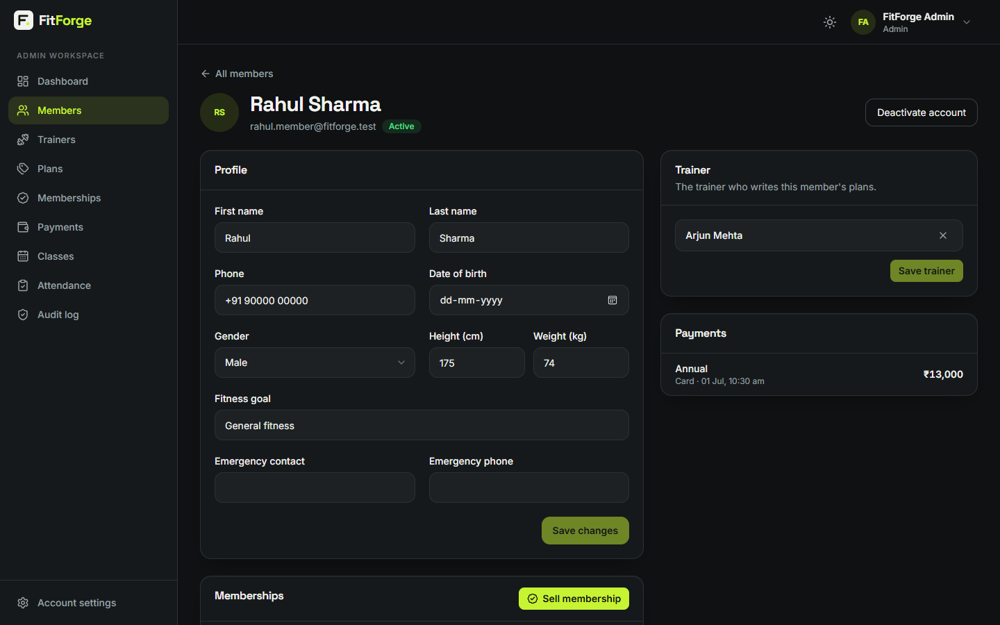 **Member detail**: profile, trainer, memberships, payments |
| 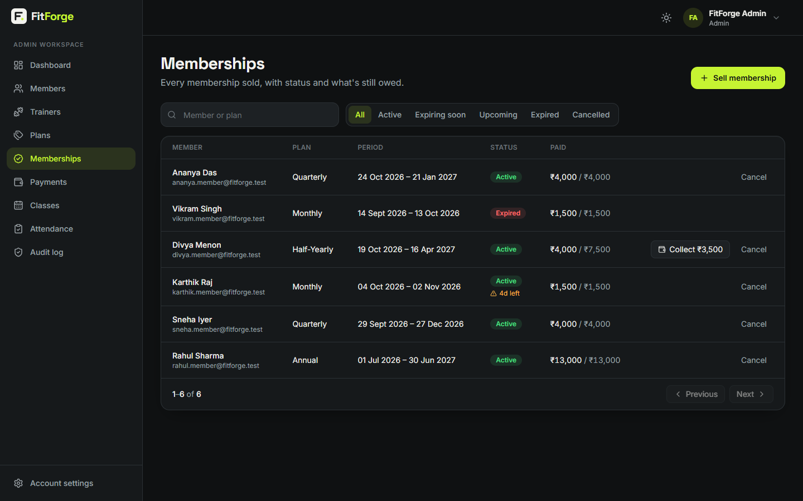 **Memberships**: active, expiring soon, upcoming, expired | 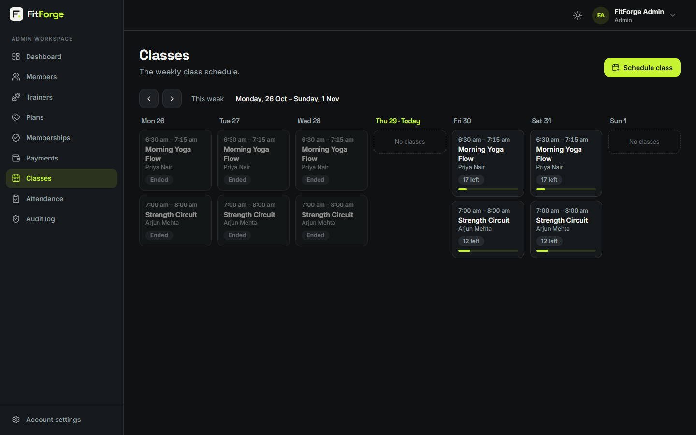 **Weekly class schedule** with capacity |
| 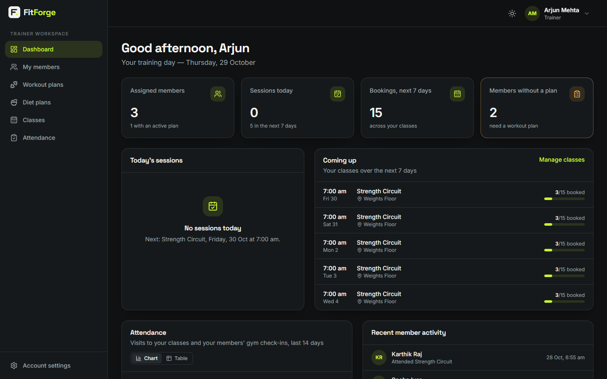 **Trainer dashboard**: sessions, bookings, members without a plan | 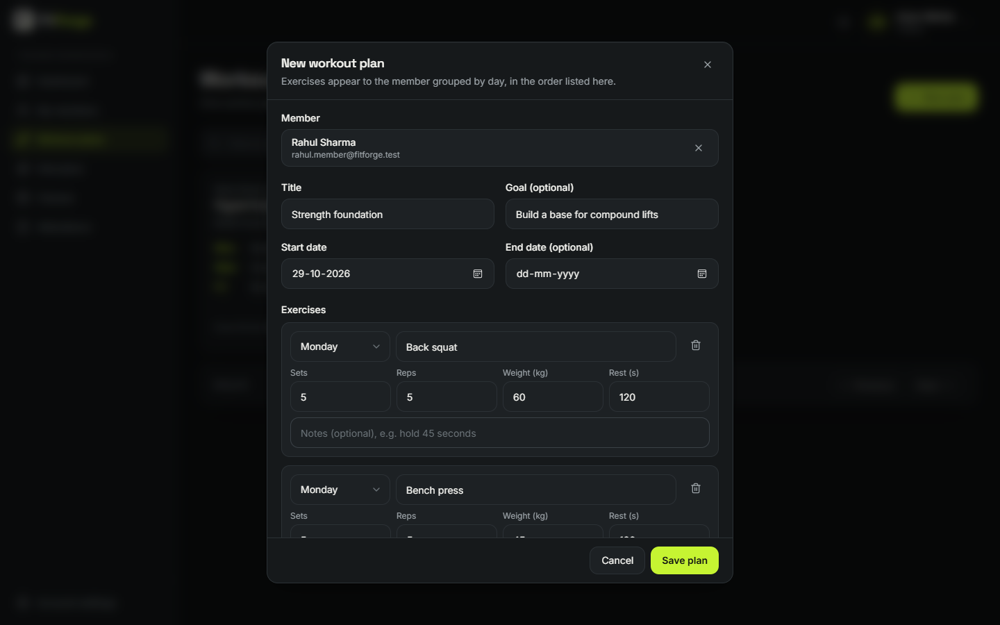 **Workout plan editor**: exercises per weekday |
| 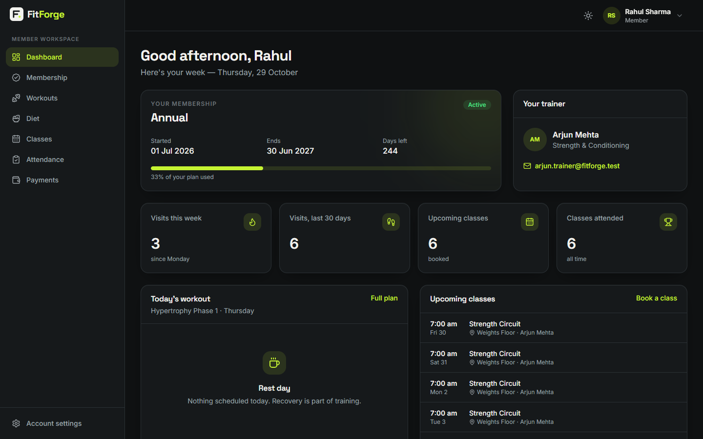 **Member dashboard**: membership, trainer, today's workout | 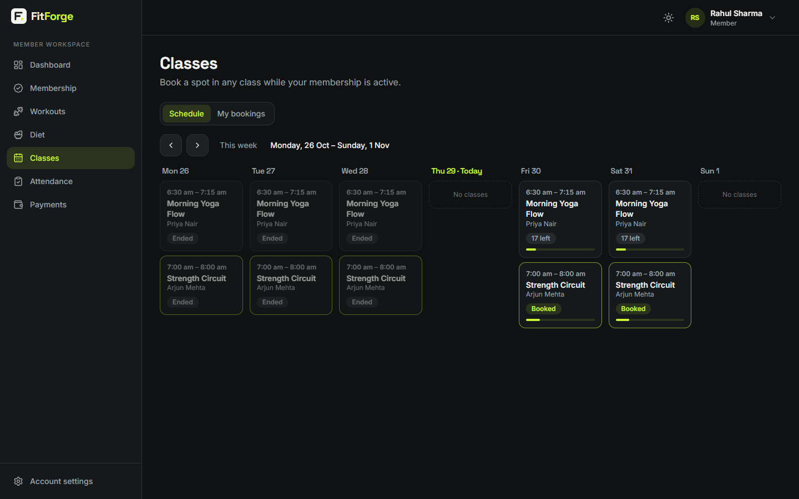 **Booking classes** as a member |
| 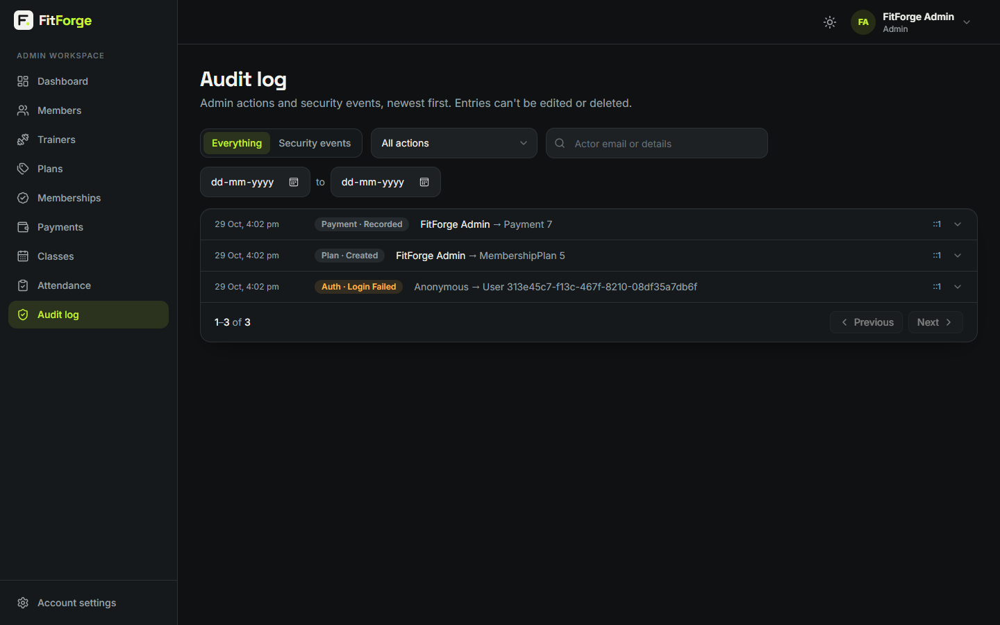 **Audit log**: admin actions and security events | 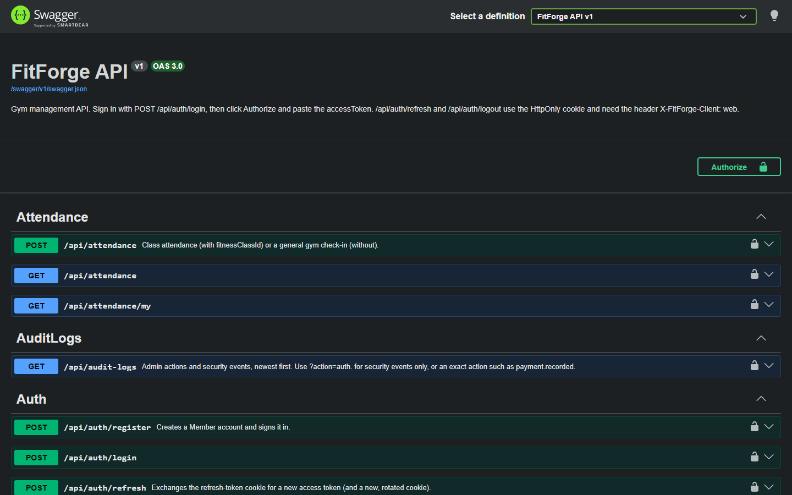 **Swagger / OpenAPI** documentation |

<p align="center">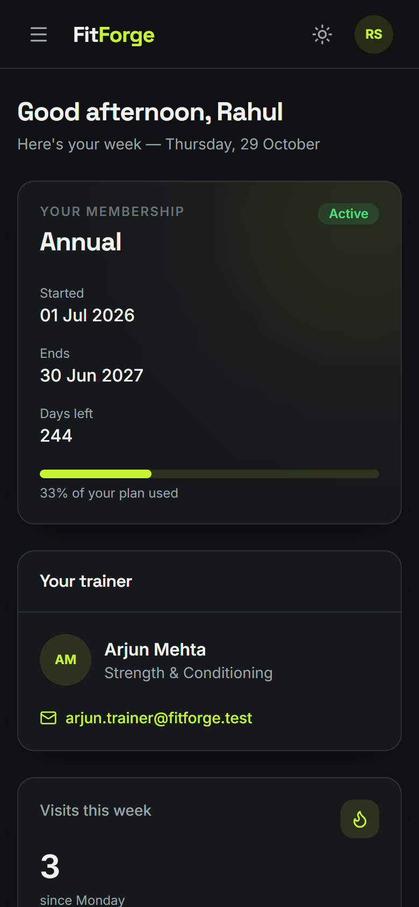<br><em>Fully responsive: member dashboard on a phone</em></p>

---

## Features by role

| Admin | Trainer | Member |
|---|---|---|
| Dashboard: active members, revenue (with month-on-month change), expiring memberships, check-ins, dues | Dashboard: today's sessions, upcoming classes and bookings, members without a plan, recent activity | Dashboard: membership progress, trainer, today's workout, upcoming classes, visits |
| Members: add, edit, assign trainer, deactivate (signs the user out everywhere) | Sees **only assigned members** | Self-service profile (phone, body stats, goal, emergency contact) |
| Trainers and membership plans | Workout plans: exercises per weekday | Workout plan by day, diet plan |
| Sell and renew memberships, collect part payments | Diet plans: targets and meals | Membership history and balances, payments |
| Schedule, edit and cancel classes; see rosters | Run own classes, mark attendance | Book and cancel classes (until 2 hours before) |
| Gym check-ins and attendance | Check members in | Own attendance |
| Audit log with security-event filter | | Register, change and reset password |

---

## Architecture

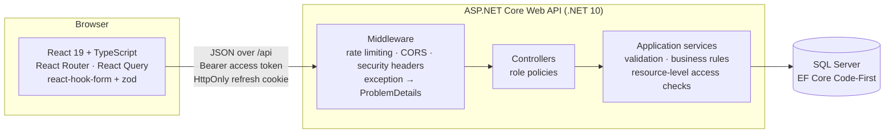

Clean Architecture with four projects:

| Project | Responsibility |
|---|---|
| `GymManagement.Domain` | Entities and enums, with no framework dependencies |
| `GymManagement.Application` | DTOs, service interfaces, FluentValidation validators |
| `GymManagement.Infrastructure` | EF Core `AppDbContext`, configurations, migrations, Identity, services (business rules, access control, audit, dashboards, tokens) |
| `GymManagement.Api` | Controllers, authorization policies, middleware, rate limiting, Swagger, startup |

```
FitForge/
├── src/                     # .NET solution (Domain, Application, Infrastructure, Api)
├── tests/
│   ├── GymManagement.UnitTests
│   └── GymManagement.IntegrationTests
├── client/                  # React + Vite + TypeScript frontend
│   └── src/{api,auth,components,layouts,lib,pages,routes,theme}
├── e2e/                     # browser end-to-end suites (puppeteer-core)
└── assets/screenshots/
```

### Key design decisions

- **Access token in memory, refresh token in an HttpOnly cookie.** No token is ever in `localStorage`, so an injected script can't steal a long-lived credential. Refresh and logout also require a custom header, which blocks cross-site request forgery.
- **Refresh-token rotation with reuse detection.** Each refresh issues a new token. Presenting an old one revokes the whole token family and is logged as a security event.
- **404 instead of 403 for other people's records,** so the API doesn't reveal which IDs exist.
- **Gym time zone (Asia/Kolkata) is explicit everywhere.** Dates are stored in UTC, "today" and day boundaries are computed in gym time through an injectable clock, and the UI never relies on the browser's time zone.
- **Concurrency-safe booking.** The class row is locked (`UPDLOCK`) inside a transaction, so simultaneous bookings for the last spot can't overbook. An integration test fires 5 at once.
- **Restrict deletes and soft deactivation.** Payments, memberships and history are never cascade-deleted.

---

## Tech stack

| Layer | Technologies |
|---|---|
| Backend | .NET 10, ASP.NET Core Web API, EF Core 10, SQL Server, ASP.NET Core Identity, JWT bearer, FluentValidation, Serilog, Swashbuckle (OpenAPI) |
| Frontend | React 19, TypeScript, Vite, React Router, TanStack Query, axios, react-hook-form, zod, Tailwind CSS 4, Recharts, lucide icons, sonner |
| Testing | xUnit v3, `WebApplicationFactory`, Microsoft.Extensions.TimeProvider.Testing, Vitest, puppeteer-core |

---

## Getting started

**Requirements:** .NET 10 SDK, SQL Server LocalDB (or any SQL Server), Node.js 20+.

### 1. API

```powershell
# Development secrets (stored outside the repository)
dotnet user-secrets set "Seed:AdminPassword" "<admin password>"           --project src/GymManagement.Api
dotnet user-secrets set "Seed:DemoPassword"  "<demo password>"            --project src/GymManagement.Api
dotnet user-secrets set "Jwt:SigningKey"     "<random string, 32+ bytes>" --project src/GymManagement.Api

dotnet run --project src/GymManagement.Api --launch-profile http
```

The first run creates the `FitForgeDb` database, applies migrations, and seeds the roles, the admin account and demo data. Then check:

- Health: `http://localhost:5080/health`
- Swagger: `http://localhost:5080/swagger`. Call `POST /api/auth/login`, click **Authorize** and paste the `accessToken`.

To use a different SQL Server, override `ConnectionStrings:DefaultConnection` (user secrets or an environment variable).

### 2. Frontend

```powershell
cd client
npm install
npm run dev
```

Open `http://localhost:5173`. Vite forwards `/api` to the API, so the browser talks to one origin and the SameSite=Strict refresh cookie works.

### Demo accounts

| Role | Email | Password |
|---|---|---|
| Admin | `admin@fitforge.test` | your `Seed:AdminPassword` |
| Trainer | `arjun.trainer@fitforge.test`, `priya.trainer@fitforge.test` | your `Seed:DemoPassword` |
| Member | `rahul.member@fitforge.test` (active), `karthik.member@…` (expiring), `divya.member@…` (balance due), `vikram.member@…` (expired) | your `Seed:DemoPassword` |

The sign-in page has one-click buttons that fill in these emails in development. For a guided 5-minute tour, see **[DEMO.md](DEMO.md)**.

---

## Testing

```powershell
dotnet test                     # 39 unit + 41 integration tests (needs LocalDB), about 10 s
cd client; npm test             # 34 client unit tests (Vitest)
cd e2e; npm install; npm test   # 119 browser checks (see e2e/README.md)
```

| Suite | Covers |
|---|---|
| **Unit** (.NET) | Membership dates and states, overlap detection, cancellation window, dashboard buckets, validators, gym clock, token hashing |
| **Integration** (.NET) | The real API in memory against a fresh SQL Server database: auth flows (rotation, reuse detection, lockout, CSRF header), 401/403/404 rules, business rules, concurrent booking race, ProblemDetails, security headers, CORS, audit log, rate limiting |
| **Client** (Vitest) | Time-zone conversion (run under a foreign machine time zone), currency and date formatting, chart axis ticks, API error mapping, validation schemas |
| **End-to-end** (browser) | Sign-in, guards and silent refresh; all three dashboards; admin → trainer → member workflows; mobile layout; zero console errors |

---

## API overview

| Area | Endpoints |
|---|---|
| Auth | `POST /api/auth/register · login · refresh · logout · change-password · forgot-password · reset-password`, `GET /api/auth/me` |
| People | `/api/users`, `/api/members` (+ `/me`), `/api/trainers` |
| Billing | `/api/membership-plans`, `/api/memberships` (+ `/my`), `/api/payments` (+ `/my`) |
| Training | `/api/workout-plans`, `/api/diet-plans` |
| Classes | `/api/classes`, `/api/classes/{id}/bookings` (+ `/me`), `/api/attendance` |
| Insights | `/api/dashboard/{admin,trainer,member}`, `/api/audit-logs` |

All of them are documented in Swagger, and errors use RFC 7807 ProblemDetails with camelCase field errors.

---

## Limitations and next steps

- Emails (password reset, renewal reminders) are logged in development instead of sent. An email provider would plug in behind the existing interface.
- No online payment gateway: payments are recorded by staff (cash, card, UPI, bank transfer).
- Integration tests use LocalDB. A CI pipeline would run them against a SQL Server container.

---

## Author

**Harish E**: [LinkedIn](https://www.linkedin.com/in/harish-e-60a8a52a1) · [GitHub](https://github.com/Harishelangovan)
