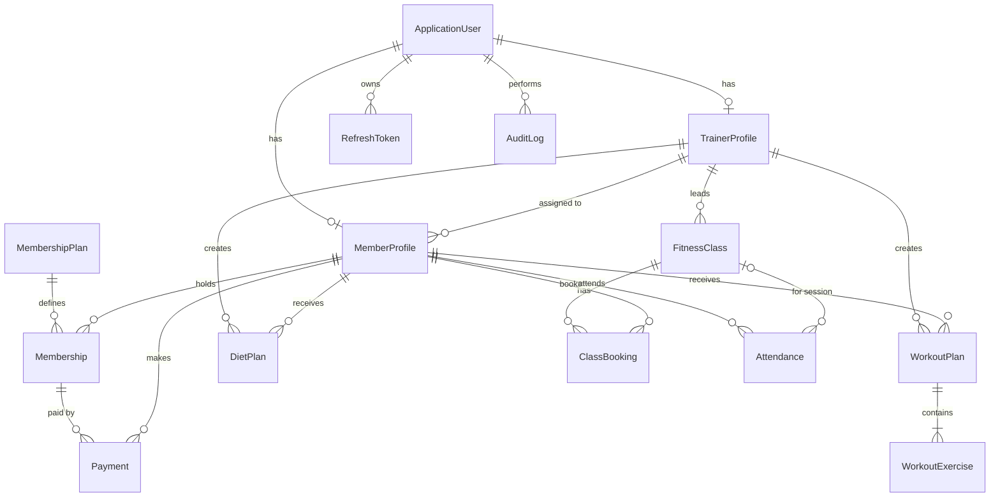

# FitForge — Phase 1: Architecture, Requirements & Data Model

Status: design only. No code has been generated, built or tested in this phase.

---

## 1. Environment (checked on this machine, 2026-10-29)

| Tool | Version found | Used for |
|---|---|---|
| .NET SDK | 10.0.300 (also 8.0.422) | Backend, target `net10.0` (current LTS) |
| dotnet-ef (global tool) | 10.0.14 | Migrations |
| Node.js / npm | 24.16.0 / 11.13.0 | React + Vite frontend |
| SQL Server | LocalDB `MSSQLLocalDB` | Development database (open in SSMS as `(localdb)\MSSQLLocalDB`) |
| Git | 2.55.0 | Source control |

A `global.json` will pin the SDK to 10.0.x so the project does not accidentally build with .NET 8.

---

## 2. Scope

### In scope
- Three roles: **Admin**, **Trainer**, **Member** (role name `User` in the spec is stored as `Member` to avoid confusion with "user account"; every account is a user, the role says what kind).
- Member self-registration (always gets the Member role), login, refresh, logout, change password, forgot/reset password.
- Admin management of members, trainers, membership plans, memberships, payments, classes, attendance, audit logs.
- Trainer management of assigned members' workout plans, diet plans, class sessions and attendance.
- Member self-service: profile, membership, plans, class booking, attendance and payment history.
- Role-specific dashboards backed by real database queries.
- Rate limiting, CORS, global error handling, structured logging, audit logging, Swagger.
- Unit and integration tests.

### Out of scope (stated so nobody assumes they exist)
- **Real payment gateway.** Payments are *recorded* by an Admin (cash, card, UPI, bank transfer at the front desk). No card data is ever handled.
- **Real email sending.** Forgot-password uses an `IEmailSender` abstraction; in development the reset link is written to the log. A real provider (SMTP/SendGrid) can be plugged in later.
- Recurring class schedules. Each `FitnessClass` row is one dated session; trainers create sessions individually (a "duplicate to next week" action can be added later).
- Multi-branch gyms, mobile apps, notifications (the `Notification` entity is deferred to a later phase if time allows).

---

## 3. Architecture decisions

### 3.1 Solution layout: 4 projects + 2 test projects

```
React (Vite) ──HTTP/JSON──► GymManagement.Api (controllers, middleware, auth, rate limiting)
                                 │
                                 ▼
                     GymManagement.Application (DTOs, service interfaces, validators)
                                 ▲
                                 │ implements
                     GymManagement.Infrastructure (EF Core DbContext, service implementations,
                                 │                  Identity, JWT, email, seeding)
                                 ▼
                           SQL Server (LocalDB)

GymManagement.Domain (entities, enums) — referenced by Application and Infrastructure
```

Project references (arrows = "depends on"):

- `Api` → `Application`, `Infrastructure`
- `Infrastructure` → `Application`, `Domain`
- `Application` → `Domain`
- `Domain` → nothing (updated in Phase 2: Domain references `Microsoft.Extensions.Identity.Stores` so `ApplicationUser` can live beside the entities that navigate to it; see phase-2-database.md)

**Trade-off vs a single project:** four projects add some ceremony (more `.csproj` files, more namespaces), but they make dependency direction enforceable by the compiler: controllers cannot touch the DbContext directly, and entities cannot depend on ASP.NET. That is a common interview topic and shows well on GitHub. A single project would be faster to start but tends to let business logic leak into controllers.

### 3.2 No generic repository

Service implementations in `Infrastructure/Services` use `AppDbContext` directly. EF Core's `DbSet<T>` already is a repository and `DbContext` already is a unit of work; wrapping them in `IRepository<T>` would only hide useful EF features (`Include`, projections, `AsNoTracking`). Service **interfaces** live in `Application/Interfaces`, so controllers and tests depend on abstractions, not on EF.

Request flow:

```
React page → apiClient (Axios) → Controller → IXxxService → XxxService → AppDbContext → SQL Server
```

Controllers only: read the request DTO, call the service, map the result to an HTTP status code.

### 3.3 Identity

ASP.NET Core Identity (`IdentityUser<Guid>` / `IdentityRole<Guid>`) with **Identity's own password hasher** (PBKDF2 with HMAC-SHA512, random per-user salt, 100,000 iterations in current versions). We use `UserManager`/`SignInManager` APIs for create, password checks and lockout, but **not** Identity's cookie UI or the built-in `MapIdentityApi` endpoints, because we need custom JWT + refresh-token behaviour.

Identity lockout gives the account-aware part of login protection: 5 failed attempts → 15-minute lockout.

### 3.4 Tokens and browser storage

| Token | Lifetime | Where it lives | Why |
|---|---|---|---|
| Access token (JWT) | 15 minutes | React memory (a module variable), never `localStorage` | An XSS bug can't read it from storage after a page reload; short life limits damage |
| Refresh token | 7 days, rotated on every use | `HttpOnly; Secure; SameSite=Strict` cookie, path `/api/auth` | JavaScript cannot read it at all |

- Refresh tokens are random 64-byte values; **only a SHA-256 hash is stored** in the database.
- **Rotation + reuse detection:** each refresh issues a new token and revokes the old one. If a revoked token is presented again, the whole token family is revoked (sign-out everywhere), because that means it was stolen.
- **CSRF:** the only cookie-authenticated endpoints are `/api/auth/refresh` and `/api/auth/logout`. They are protected by `SameSite=Strict`, a strict CORS origin, and a required custom header (`X-FitForge-Client: web`), which a cross-site form cannot send.
- In development, Vite proxies `/api` to the backend, so the browser sees one origin and `SameSite=Strict` cookies work without HTTPS cross-origin tricks.
- On page reload, the app calls `/api/auth/refresh` once to get a fresh access token from the cookie.

JWT validation: signature (HMAC-SHA256, key ≥ 32 bytes from user secrets / environment variable), issuer, audience, lifetime, `ClockSkew = 30s`. Claims: `sub` (user id), `email`, `role`, `jti`. Nothing else.

### 3.5 Authorization

1. **Role policies** — `AdminOnly`, `TrainerOrAdmin`, `MemberOnly`, `Authenticated`.
2. **Resource-level checks inside services** (prevents IDOR):
   - "My" endpoints (`/api/memberships/my`, `/api/payments/my`, …) never take a member ID; it comes from the token's `sub` claim.
   - When a trainer acts on a member, the service checks `member.AssignedTrainerId == currentTrainer.Id`; otherwise it returns **404** (not 403), so IDs of other people's records are not confirmed to exist.
   - Admin bypasses ownership checks but every sensitive admin action is audit-logged.
3. Public registration DTO has **no role field**; the service always assigns `Member`. Trainers and admins are created only by an admin endpoint.

### 3.6 Rate limiting (built-in `Microsoft.AspNetCore.RateLimiting`)

| Policy | Limit (initial) | Partition key |
|---|---|---|
| `login` | 5 requests / minute | client IP |
| `register` | 3 / 10 minutes | client IP |
| `password-reset` | 3 / 15 minutes | client IP |
| `authenticated` | 100 / minute | user id from token |
| `public-read` | 60 / minute | client IP |

- Rejections return **429** with a `Retry-After` header and a JSON problem response.
- The IP comes from `HttpContext.Connection.RemoteIpAddress`. `X-Forwarded-For` is only honoured through `ForwardedHeadersMiddleware` with **explicitly configured `KnownProxies`/`KnownNetworks`**, so a client cannot change its partition by sending a fake header.
- Login is protected twice: per-IP rate limit **and** per-account Identity lockout.
- The limiter is **in-memory, per application instance**. Running several instances behind a load balancer would need a gateway (Azure Front Door, NGINX, API Management) or a distributed limiter (Redis). This is documented, not implemented.

### 3.7 Other cross-cutting decisions

- **Validation:** FluentValidation validators in `Application/Validators`, run automatically through a filter; business rules (e.g., "class is full") are checked in services.
- **Errors:** one global exception handler (`IExceptionHandler`) → RFC 7807 `ProblemDetails`. Known business errors map to 400/404/409; anything else → 500 with a generic message and a `traceId`. No stack traces or SQL errors leave the server.
- **Response shape:** success = the DTO itself (or `PagedResult<T>` with `items`, `page`, `pageSize`, `totalCount`); errors = `ProblemDetails`. No custom `{ success, data }` wrapper, because HTTP status codes already say success or failure.
- **Logging:** Serilog to console and rolling files. Passwords, tokens and `Authorization`/`Cookie` headers are never logged.
- **Time:** all timestamps stored as UTC (`DateTime` with `...Utc` suffix in names); dates without time (membership start/end) use `DateOnly`.
- **Money:** `decimal(10,2)`, currency INR, configured in one place.
- **CORS:** only the configured frontend origin (`http://localhost:5173` in development), credentials allowed.
- **HTTPS:** enforced (`UseHttpsRedirection` + HSTS) outside development.
- **Swagger:** Swashbuckle UI with a Bearer-token "Authorize" button, enabled in development only.

---

## 4. Data model

### 4.1 Relationships in plain words

- An **ApplicationUser** (Identity account) has exactly one role and, depending on that role, exactly one **MemberProfile** or one **TrainerProfile** (1 : 0..1 each). Admins have neither.
- A **TrainerProfile** is assigned many **MemberProfiles**; a member has at most one assigned trainer (`AssignedTrainerId`, nullable).
- A **MembershipPlan** (e.g., "Quarterly – ₹4,500 – 90 days") is used by many **Memberships**.
- A **MemberProfile** has many **Memberships** over time (history). Renewing creates a new row starting when the previous one ends.
- A **Membership** has many **Payments** (allows part-payments); each payment also stores the `MemberProfileId` directly for fast "my payments" queries.
- A trainer creates many **WorkoutPlans** for their members; each plan has many **WorkoutExercises** (ordered, grouped by day).
- A trainer creates many **DietPlans** for their members.
- A **FitnessClass** is one dated session, led by one trainer, with a capacity. It has many **ClassBookings**.
- A member can't hold two active bookings for the same class: **filtered unique index** on `(FitnessClassId, MemberProfileId) WHERE Status = Booked`, so a member can cancel and rebook.
- An **Attendance** record references a member, optionally a class session (null = general gym check-in), and the user who marked it.
- **RefreshToken** belongs to a user. **AuditLog** references the acting user (nullable, kept if the user is later deactivated).

### 4.2 ER diagram



### 4.3 Entities (key fields)

| Entity | Key fields | Constraints / indexes |
|---|---|---|
| **ApplicationUser** (Identity) | `Id` Guid, `Email`, `FirstName`, `LastName`, `PhoneNumber`, `IsActive`, `CreatedUtc` | Unique normalized email (Identity) |
| **ApplicationRole** (Identity) | `Id` Guid, `Name` ∈ Admin / Trainer / Member | Seeded |
| **MemberProfile** | `Id`, `UserId` (unique FK), `DateOfBirth` DateOnly?, `Gender`, `HeightCm`, `WeightKg` decimal(5,2), `FitnessGoal`, `EmergencyContactName/Phone`, `AssignedTrainerId?`, `JoinedOn` DateOnly | Unique `UserId`; index `AssignedTrainerId` |
| **TrainerProfile** | `Id`, `UserId` (unique FK), `Specialization`, `Bio`, `YearsOfExperience`, `IsAcceptingMembers` | Unique `UserId` |
| **MembershipPlan** | `Id`, `Name`, `Description`, `DurationDays`, `Price` decimal(10,2), `IsActive` | Unique `Name`; check `DurationDays > 0`, `Price >= 0` |
| **Membership** | `Id`, `MemberProfileId`, `MembershipPlanId`, `StartDate`, `EndDate` (DateOnly), `PriceAtPurchase` decimal(10,2), `Status` (Active/Cancelled), `CreatedUtc` | Index `(MemberProfileId, EndDate)`; check `EndDate >= StartDate`. "Expired" is computed from `EndDate`, not stored, so it never goes stale |
| **Payment** | `Id`, `MembershipId`, `MemberProfileId`, `Amount` decimal(10,2), `Method` (Cash/Card/UPI/BankTransfer), `ReferenceNumber?`, `PaidUtc`, `RecordedByUserId`, `Notes?` | Index `(MemberProfileId, PaidUtc)`, `PaidUtc`; check `Amount > 0` |
| **WorkoutPlan** | `Id`, `MemberProfileId`, `TrainerProfileId`, `Title`, `Goal`, `StartDate`, `EndDate?`, `IsActive`, `CreatedUtc`, `UpdatedUtc` | Index `(MemberProfileId, IsActive)` |
| **WorkoutExercise** | `Id`, `WorkoutPlanId`, `DayOfWeek`, `Name`, `Sets`, `Reps`, `WeightKg?`, `RestSeconds`, `Notes?`, `SortOrder` | Cascade delete with plan; check `Sets > 0`, `Reps > 0` |
| **DietPlan** | `Id`, `MemberProfileId`, `TrainerProfileId`, `Title`, `DailyCalories`, `ProteinGrams`, `Breakfast`, `Lunch`, `Dinner`, `Snacks`, `Notes?`, `IsActive`, `CreatedUtc`, `UpdatedUtc` | Index `(MemberProfileId, IsActive)` |
| **FitnessClass** | `Id`, `Title`, `Description`, `TrainerProfileId`, `StartUtc`, `EndUtc`, `Capacity`, `Location`, `IsCancelled` | Index `StartUtc`, `(TrainerProfileId, StartUtc)`; check `EndUtc > StartUtc`, `Capacity > 0` |
| **ClassBooking** | `Id`, `FitnessClassId`, `MemberProfileId`, `Status` (Booked/Cancelled), `BookedUtc`, `CancelledUtc?` | **Filtered unique** `(FitnessClassId, MemberProfileId) WHERE Status = 0` |
| **Attendance** | `Id`, `MemberProfileId`, `FitnessClassId?`, `CheckInUtc`, `MarkedByUserId` | Index `(MemberProfileId, CheckInUtc)`; filtered unique `(MemberProfileId, FitnessClassId) WHERE FitnessClassId IS NOT NULL` |
| **RefreshToken** | `Id`, `UserId`, `TokenHash` (64-char hex), `FamilyId`, `CreatedUtc`, `ExpiresUtc`, `RevokedUtc?`, `ReplacedByTokenHash?`, `CreatedByIp` | Unique `TokenHash`; index `(UserId, FamilyId)`; cascade with user |
| **AuditLog** | `Id` bigint, `ActorUserId?`, `Action`, `EntityType`, `EntityId`, `Details` (JSON, no secrets), `IpAddress`, `CreatedUtc` | Index `CreatedUtc`, `(EntityType, EntityId)` |

**Delete behaviour:** `Restrict` everywhere by default (no accidental cascades through financial history). Exceptions: `WorkoutPlan → WorkoutExercise` and `User → RefreshToken` cascade. Users and trainers are **deactivated** (`IsActive = false`), never hard-deleted.

### 4.4 Business rules (enforced in services, covered by tests)

1. Public registration always creates a **Member**; email must be unique (case-insensitive).
2. A deactivated user cannot log in or refresh tokens.
3. A member has at most one membership covering any given day. Renewal starts the day after the current `EndDate`.
4. Payments must be > 0 and cannot exceed the membership's outstanding balance.
5. Booking a class requires: active membership on the class date, class not cancelled, not started, not full, no existing active booking.
6. Cancelling a booking is allowed until **2 hours** before the class starts.
7. Trainers can read/write only members assigned to them, and only classes they lead.
8. Attendance for a class can be marked only by the class's trainer or an admin, for members with a booking.
9. Only admins can change roles, deactivate users, edit plans and record payments.
10. Every admin create/update/deactivate and every role change writes an `AuditLog` row.

---

## 5. Folder structure

```
FitForge/
├─ global.json
├─ FitForge.sln
├─ README.md
├─ .gitignore
├─ docs/
│  └─ phase-1-architecture.md
├─ src/
│  ├─ GymManagement.Domain/
│  │  ├─ Common/          (BaseEntity, IAuditableEntity)
│  │  ├─ Entities/
│  │  └─ Enums/
│  ├─ GymManagement.Application/
│  │  ├─ Common/          (PagedResult, PageQuery, exceptions: NotFound, Conflict, BusinessRule)
│  │  ├─ DTOs/<Module>/
│  │  ├─ Interfaces/      (IAuthService, IMembershipService, ICurrentUser, …)
│  │  └─ Validators/
│  ├─ GymManagement.Infrastructure/
│  │  ├─ Data/            (AppDbContext, Migrations/, Seed/)
│  │  ├─ Configurations/  (IEntityTypeConfiguration<T> per entity)
│  │  ├─ Identity/        (ApplicationUser, ApplicationRole, JwtTokenService, RefreshTokenService)
│  │  ├─ Services/        (service implementations)
│  │  └─ DependencyInjection.cs
│  └─ GymManagement.Api/
│     ├─ Authorization/   (policy names, CurrentUser)
│     ├─ Controllers/
│     ├─ Extensions/      (AddJwtAuth, AddRateLimits, AddSwaggerWithJwt, AddCorsPolicy)
│     ├─ Middleware/      (GlobalExceptionHandler)
│     ├─ Program.cs
│     └─ appsettings.json / appsettings.Development.json
├─ tests/
│  ├─ GymManagement.UnitTests/
│  └─ GymManagement.IntegrationTests/
└─ client/                (React + Vite + TypeScript)
   ├─ index.html
   ├─ vite.config.ts      (dev proxy /api → backend)
   ├─ .env.example
   └─ src/
      ├─ api/             (apiClient.ts, one file per module)
      ├─ auth/            (AuthProvider, useAuth, RequireRole)
      ├─ components/ui/   (Button, Input, Card, DataTable, Modal, Skeleton, EmptyState, Badge)
      ├─ components/charts/
      ├─ layouts/         (AppShell with sidebar + topbar, AuthLayout)
      ├─ features/        (members, trainers, plans, memberships, payments, workouts, diets, classes, attendance, audit)
      ├─ pages/           (dashboards, login, register, 403, 404, …)
      ├─ routes/          (router.tsx)
      ├─ lib/             (formatters, zod schemas, constants)
      └─ styles/          (index.css with Tailwind + design tokens)
```

---

## 6. Dependencies

Exact patch versions are pinned when they are installed in Phase 2 / Phase 6 (the resolved versions will be recorded in the README). All Microsoft packages use the **10.0.x** line to match the SDK.

### Backend (NuGet)

| Project | Package | Purpose |
|---|---|---|
| Infrastructure | `Microsoft.EntityFrameworkCore.SqlServer` 10.0.x | EF Core SQL Server provider |
| Infrastructure | `Microsoft.EntityFrameworkCore.Design` 10.0.x | Migrations tooling |
| Infrastructure | `Microsoft.AspNetCore.Identity.EntityFrameworkCore` 10.0.x | Identity stores + password hasher |
| Api | `Microsoft.AspNetCore.Authentication.JwtBearer` 10.0.x | JWT validation |
| Api | `Swashbuckle.AspNetCore` (latest stable) | Swagger UI with Bearer auth |
| Api | `Serilog.AspNetCore` (latest stable) | Structured logging |
| Application | `FluentValidation` + `FluentValidation.DependencyInjectionExtensions` (latest stable) | Request validation |
| Tests | `xunit.v3`, `Microsoft.NET.Test.Sdk`, `Microsoft.AspNetCore.Mvc.Testing` 10.0.x, `NSubstitute` | Unit + integration tests |

Built into the framework (no package): rate limiting, `IExceptionHandler`, `ProblemDetails`, CORS, forwarded headers.

Tests use plain xUnit `Assert` (FluentAssertions now needs a commercial licence, so it is avoided).

### Frontend (npm)

| Package | Purpose |
|---|---|
| `react`, `react-dom`, `typescript`, `vite`, `@vitejs/plugin-react` | Base (Vite `react-ts` template) |
| `react-router` | Routing (v7) |
| `axios` | HTTP client with interceptors |
| `tailwindcss`, `@tailwindcss/vite` | Styling (Tailwind v4) |
| `recharts` | Charts |
| `react-hook-form`, `zod`, `@hookform/resolvers` | Forms + validation |
| `lucide-react` | Icons |
| `sonner` | Toast notifications |
| `@tanstack/react-query` | Server-state caching, loading/error states, refetching |
| `clsx` | Conditional class names |

`@tanstack/react-query` and `sonner` were not in the brief; they replace a lot of hand-written loading/error/toast code and are widely used.

---

## 7. Test strategy (built in Phase 9)

- **Unit tests:** validators and business rules (membership overlap, booking rules, cancellation window, payment balance) using services against an isolated database.
- **Integration tests:** `WebApplicationFactory<Program>` against a dedicated LocalDB database `FitForge_Tests`, created and migrated once per test run. Covers registration/login, duplicate email, wrong password (generic error), member-to-member isolation, trainer access, 429 responses, validation `ProblemDetails`.
- Real SQL Server (not the EF InMemory provider) is used, so the filtered unique indexes and check constraints are actually exercised. On CI this would be a SQL Server Docker container.

---

## 8. Phase checklist

- [x] Phase 1 — Architecture, requirements, data model, folder structure, dependencies
- [ ] Phase 2 — Solution setup, entities, DbContext, configurations, migrations, seed data
- [ ] Phase 3 — Identity, password hashing, JWT, refresh tokens, roles, policies
- [ ] Phase 4 — Services, DTOs, validation, CRUD APIs, resource-level authorization
- [ ] Phase 5 — Rate limiting, CORS, exception handling, audit logging, Swagger, hardening
- [ ] Phase 6 — React setup, design system, routing, auth integration, layouts
- [ ] Phase 7 — Admin, trainer, member dashboards on live APIs
- [ ] Phase 8 — Memberships, payments, workouts, diets, bookings, attendance UI
- [ ] Phase 9 — Automated tests, fixes, responsive and security checks
- [ ] Phase 10 — README, demo prep, resume description
